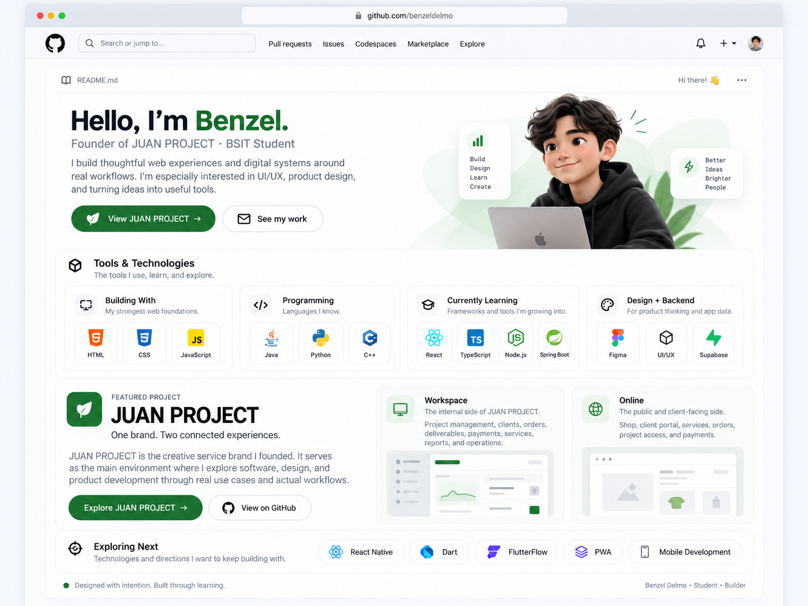
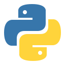
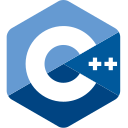
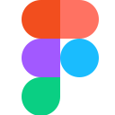
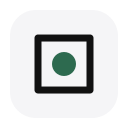
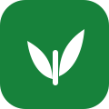
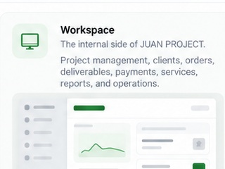
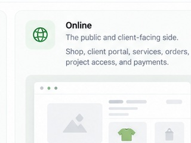
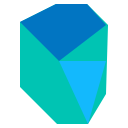
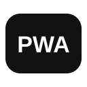

<!--
  GitHub Profile README — benzeldelmo/benzeldelmo
  Keep README.md and the assets/ folder together.
-->

  

 

# Hello, I’m Benzel.

### Founder of JUAN PROJECT · BSIT Student

I build thoughtful web experiences and digital systems around real workflows. I’m especially interested in **UI/UX, product design, and turning ideas into useful tools.**

  <a href="https://github.com/benzeldelmo/juan-project-suite"><strong>View JUAN PROJECT →</strong></a>
  &nbsp;&nbsp;·&nbsp;&nbsp;
  <a href="https://github.com/benzeldelmo?tab=repositories">See my work</a>

---

## Tools & Technologies

The tools I use, learn, and explore.

  

<table>
<tr>
<td width="25%" valign="top">

### Building With
My strongest web foundations.

 

&nbsp;&nbsp;
&nbsp;&nbsp;

  

**HTML · CSS · JavaScript**

</td>
<td width="25%" valign="top">

### Programming
Languages I know.

 

&nbsp;&nbsp;
&nbsp;&nbsp;

  

**Java · Python · C++**

</td>
<td width="25%" valign="top">

### Currently Learning
Frameworks and tools I’m growing into.

 

&nbsp;&nbsp;
&nbsp;&nbsp;
&nbsp;&nbsp;

  

**React · TypeScript · Node.js · Spring Boot**

</td>
<td width="25%" valign="top">

### Design + Backend
For product thinking and app data.

 

&nbsp;&nbsp;
&nbsp;&nbsp;

  

**Figma · UI/UX · Supabase**

</td>
</tr>
</table>

 

---

## Featured Project

<table>
<tr>
<td width="44%" valign="top">

### JUAN PROJECT

#### One brand. Two connected experiences.

JUAN PROJECT is the **creative service brand I founded**. It serves as the main environment where I explore software, design, and product development through real use cases and actual workflows.

 

<a href="https://github.com/benzeldelmo/juan-project-suite"><strong>Explore JUAN PROJECT →</strong></a>

</td>
<td width="28%" valign="top">

### Workspace
The internal side of JUAN PROJECT.

Project management, clients, orders, deliverables, payments, services, reports, and operations.

 

</td>
<td width="28%" valign="top">

### Online
The public and client-facing side.

Shop, client portal, services, orders, project access, and payments.

 

</td>
</tr>
</table>

 

---

## Exploring Next

Technologies and directions I want to keep building with.

  

  &nbsp;&nbsp; <strong>React Native</strong>
  &nbsp;&nbsp;&nbsp;&nbsp;
  &nbsp;&nbsp; <strong>Dart</strong>
  &nbsp;&nbsp;&nbsp;&nbsp;
  &nbsp;&nbsp; <strong>FlutterFlow</strong>
  &nbsp;&nbsp;&nbsp;&nbsp;
  &nbsp;&nbsp; <strong>PWA</strong>
  &nbsp;&nbsp;&nbsp;&nbsp;
  <strong>Mobile Development</strong>

 

---

  <strong>Designed with intention. Built through learning.</strong> 
  Benzel Delmo · Student · Builder

