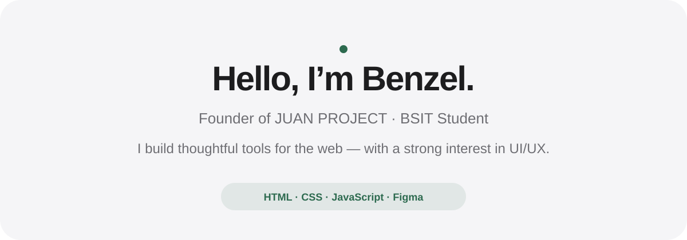
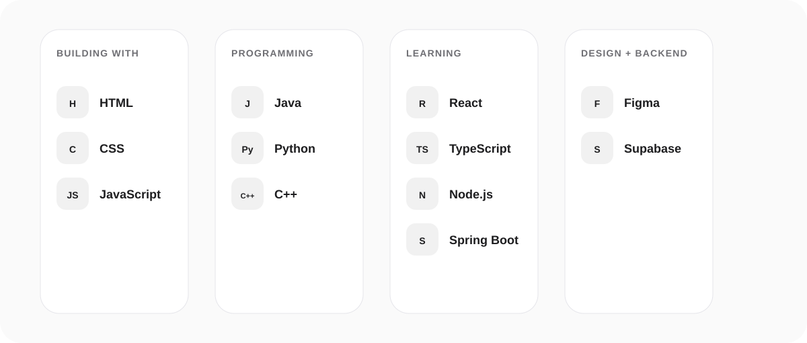
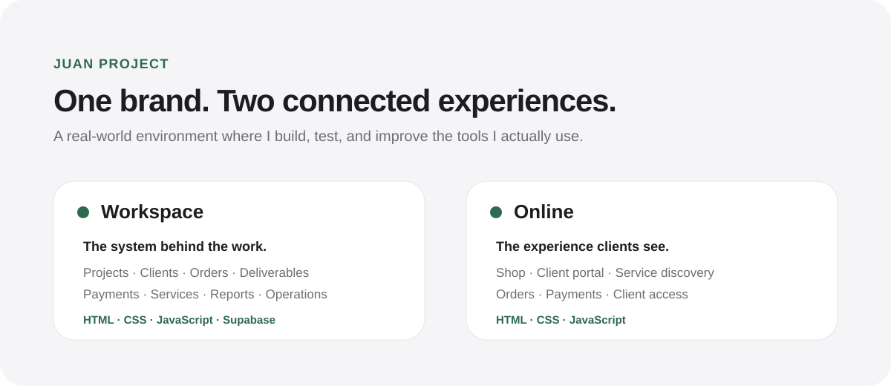
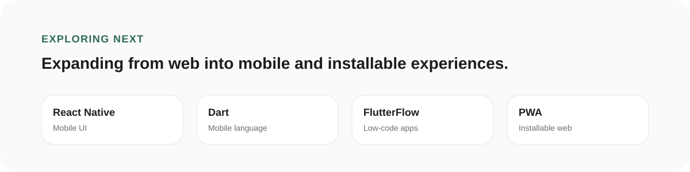

  <picture>
    <source media="(prefers-color-scheme: dark)" srcset="./assets/hero-dark.svg">
    <source media="(prefers-color-scheme: light)" srcset="./assets/hero-light.svg">
    
  </picture>

 

  <strong>Developer · Designer · Founder</strong> 
  Building thoughtful web experiences and learning by solving real workflow problems.

 

## What I work with

  <picture>
    <source media="(prefers-color-scheme: dark)" srcset="./assets/stack-dark.svg">
    <source media="(prefers-color-scheme: light)" srcset="./assets/stack-light.svg">
    
  </picture>

Building with <strong>HTML, CSS, and JavaScript</strong>. I also have programming experience with <strong>Java, Python, and C++</strong>, and I’m currently learning <strong>React, TypeScript, Node.js, and Spring Boot</strong>. For design and product work, I use <strong>Figma</strong> and enjoy UI/UX design. I also use <strong>Supabase</strong> for backend services in my projects.

  

## Featured work

  <picture>
    <source media="(prefers-color-scheme: dark)" srcset="./assets/juan-dark.svg">
    <source media="(prefers-color-scheme: light)" srcset="./assets/juan-light.svg">
    
  </picture>

**JUAN PROJECT** is the creative service brand I founded. Its digital platform is split into two connected experiences:

- **Workspace** — my internal project-management environment for projects, clients, orders, deliverables, payments, services, reports, and operations.
- **Online** — JUAN PROJECT’s designated shop and client portal for services, client access, orders, projects, and payments.

 

## Exploring next

  <picture>
    <source media="(prefers-color-scheme: dark)" srcset="./assets/explore-dark.svg">
    <source media="(prefers-color-scheme: light)" srcset="./assets/explore-light.svg">
    
  </picture>

I’m exploring **React Native, Dart, FlutterFlow, progressive web apps, and mobile development** — especially tools that can turn ideas and personal workflows into useful products.

 

## How I build

I like working at the intersection of **development, UI/UX, and product thinking**.

JUAN PROJECT gives me a real environment where I can design around actual workflows, improve systems I personally use, test ideas, and continuously evolve the product as I learn.

 

  <strong>Designed with intention. Built through learning.</strong> 
  BS Information Technology · Batangas State University

