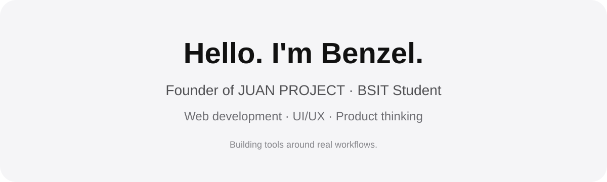

  

 

## What I work with

### Building with

  &nbsp;&nbsp;&nbsp;
  &nbsp;&nbsp;&nbsp;
  

**HTML · CSS · JavaScript**

### Programming experience

  &nbsp;&nbsp;&nbsp;
  &nbsp;&nbsp;&nbsp;
  

**Java · Python · C++**

### Currently learning

  &nbsp;&nbsp;&nbsp;
  &nbsp;&nbsp;&nbsp;
  &nbsp;&nbsp;&nbsp;
  

**React · TypeScript · Node.js · Spring Boot**

### Design & backend tools

  &nbsp;&nbsp;&nbsp;
  

**Figma · UI/UX Design · Supabase**

### Exploring

  &nbsp;&nbsp;&nbsp;
  &nbsp;&nbsp;&nbsp;
  &nbsp;&nbsp;&nbsp;
  

**React Native · Dart · FlutterFlow · PWA · Mobile Development**

 

---

## JUAN PROJECT

### One brand. Two connected experiences.

JUAN PROJECT is the creative service brand I founded and the main environment where I explore software, design, and product development.

 

<table>
<tr>
<td width="50%" valign="top">

### JUAN PROJECT Workspace

**The system behind the work.**

My internal project-management environment for managing JUAN PROJECT's projects, clients, orders, deliverables, payments, services, reports, and day-to-day operations.

**Built with:** HTML · CSS · JavaScript · Supabase

</td>
<td width="50%" valign="top">

### JUAN PROJECT Online

**The experience clients see.**

JUAN PROJECT's designated shop and client portal for presenting services, handling client access, and supporting interactions around projects, orders, and payments.

**Built with:** HTML · CSS · JavaScript

</td>
</tr>
</table>

---

## How I build

I like working at the intersection of **development, UI/UX, and product thinking**.

JUAN PROJECT gives me a real environment where I can design around actual workflows, improve systems I personally use, test ideas, and continuously evolve the product as I learn.

I'm especially interested in **web development, progressive web apps, workflow-focused tools, and eventually mobile development**.

---

### Designed with intention. Built through learning.

BS Information Technology · Batangas State University

